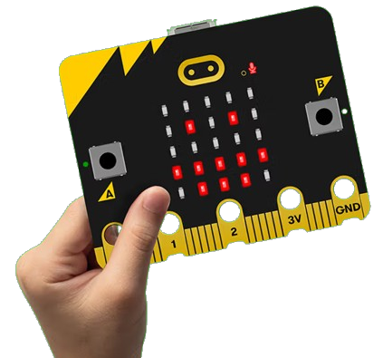

# Wokingham Library Code Club

[About the Code Club](https://github.com/WokLibCodeClub/woklibcodeclub.github.io/blob/master/README.md)

## Next Code Club sessions: Saturday 28th November 2026

<h2>
$\color{#f00}{\textsf{PLEASE MAKE SURE YOU KNOW YOUR PASSWORD FOR LOGGING IN TO YOUR ACCOUNT(S)!!!!!!!}}$
</h2>

---

# Information for Scratch session (10.30am to 11.30am)



At the next session we will be meeting the BBC micro:bit - a very sophisticated microprocessor which is popular in schools across the country. We will learn some basic functions and start coding a seasonal project.

We hope you will continue progressing at home with the Rapid Router game. See how far you can get! Go to [Rapid Router](https://www.codeforlife.education/rapidrouter/). If you have an account you can log in and check your progress.

If you didn't quite finish the *Catch the Bus* project at the last session you can work on it at home. The instructions are here: [Catch the Bus](https://projects.raspberrypi.org/en/projects/catch-the-bus).

<details><summary></summary> 
https://www.bebras.uk/index.php?action=anon_join&grp_id=28132
</details>

## Code Club Scratch Studio

We encourage our coders to share their code with others in the group, which they can do by uploading projects to the Code Club's *Scratch Studio*. This is a page on the Scratch website for sharing projects. The link is [WLCC 2026-27](https://scratch.mit.edu/studios/51996147). **Note** if you want to load one of your projects to the studio you must ***share*** it first. We will show you how to add projects to the studio at the next session.

The studio is only open for adding projects during Code Club sessions at the library. At other times you can't add projects but you can look at the projects which are already there.

## How to make a Scratch account

If you don't have an account already you can create one by going to [Join Scratch](https://scratch.mit.edu/join). You will need to use a parent's valid email address to sign up.

### Parental consent for Scratch accounts

Scratch has recently made some changes to the terms and conditions which require age verification by a parent or adult, for users under 16 years old. This will consist of **an email sent to the parent's email address with a box to click to confirm that you give permission to your child to use Scratch**.

***PARENTS: IT IS ESSENTIAL THAT YOU GIVE PERMISSION OTHERWISE YOUR CHILD WILL NOT BE ABLE TO USE SCRATCH PROPERLY IN THE CODE CLUB SESSIONS!***

## How to make a Code for Life account

To make a *Code for Life* account you will need to use a parent's email address. Go to [www.codeforlife.education/register_form](https://www.codeforlife.education/register_form): enter your date of birth in the **Independent learner** section then fill in the rest of the details, including your parent's email address. *YOU DO NOT NEED A COMPLICATED PASSWORD FOR A CODE FOR LIFE ACCOUNT - a mix of capital letters, lower-case letters and numbers will be good enough.*  Choose something which is easy to type in when you are at Code Club sessions. There is a website [dinopass.com](https://dinopass.com/) which generates simple passwords. In most cases you only need to change one lower-case letter to a capital letter and it will be accepted by Code for Life.

***NEVER USE YOUR EMAIL PASSWORD FOR YOUR CODE FOR LIFE ACCOUNT!!***

Once you have made an account you can login by going to [www.codeforlife.education/play/](https://www.codeforlife.education/play/) and clicking on the *Log in* button and choosing the option Independent.

---

# Information for Python session (11.45am to 12.45pm)

The next session will take place on **Saturday 28th November 2026**.


At the next session we will be writing Python code for the BBC micro:bit computer, which you might have seen at school. We will explore some of the basic functions including displaying custom made images and sending messages by radio from one micro:bit to another.

<details><summary></summary> 
Here is some code you can use to make a custom image on your micro:bit:

```python
display.show(Image('00500:05750:57975:05750:00500'))
```
</details>

At the last Python session we completed code for getting a turtle to draw shapes of many sides. You can find the completed code for this project here: [graphics](https://trinket.strivemath.org/library/trinkets/69dd155abf91).

We also wrote a Sorting Hat programme to show how useful *lists* are in Python. You can find the code for this project here: [Sorting Hat](https://trinket.strivemath.org/library/trinkets/efb1348b57b8)
